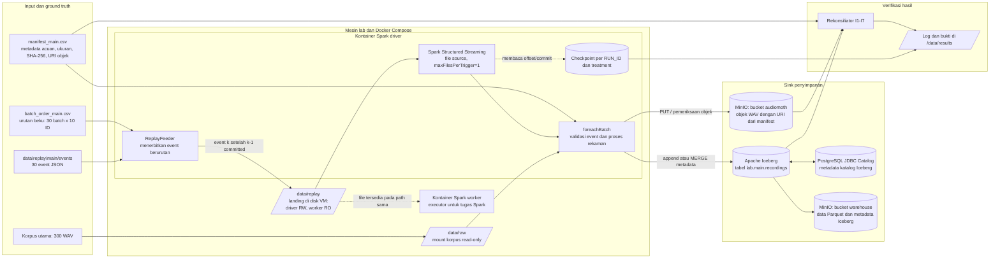

# Arsitektur Pipeline Ingest dan Pemulihan

Dokumen ini menjelaskan arsitektur sistem yang dipakai untuk membandingkan checkpoint dan idempotence pada ingest 300 rekaman WAV. Dokumen ini menggambarkan rancangan yang diterapkan kode saat ini; bukan diagram semua fault yang mungkin diuji. Versi ingest mendukung F0 (tanpa injeksi kegagalan), F1 (setelah PUT objek, sebelum metadata target di-commit), F2 (setelah semua metadata pada batch target di-commit, sebelum commit checkpoint Spark), dan F3 (setelah commit checkpoint Spark, sebelum feeder menerbitkan event berikutnya).

## Diagram komponen dan aliran data

## Peran komponen

- **Korpus WAV** adalah sumber isi rekaman. Di lab, korpus dipasang read-only pada `/data/raw`. Kode memakai `manifest_main.csv` untuk menemukan berkas, memeriksa ukuran/SHA-256 sumber, dan menentukan URI objek tujuan.
- **Manifest** adalah acuan per rekaman: `recording_id`, perangkat, waktu mulai, path sumber, ukuran, SHA-256, serta URI objek yang diharapkan. **Batch order** membekukan urutan 300 ID ke 30 batch, masing-masing 10 ID.
- **Event JSON** mengirim daftar 10 ID untuk satu batch. `ReplayFeeder` menyalin/menerbitkan event berikut ke landing setelah batch sebelumnya tercatat selesai di checkpoint. Karena tiap file merupakan satu event, Spark mengatur satu file per micro-batch dengan `maxFilesPerTrigger=1`.
- **Landing replay** berada di disk VM pada `/data/state/replay/<run_id>`, terlihat di path `/data/replay` pada kontainer. Driver menulis; worker hanya membaca. Landing menyimpan event selama umur run, termasuk saat kontainer driver diganti.
- **Spark driver** menjalankan query streaming, memvalidasi batch terhadap urutan beku, mengoordinasikan pemrosesan rekaman, mengelola checkpoint, dan menulis log. **Spark worker/executor** menyediakan komputasi terdistribusi untuk tugas Spark, termasuk operasi tulis Iceberg. Korpus dan landing dipasang pada path yang diperlukan oleh kontainer.
- **MinIO `audiomoth`** menyimpan objek WAV pada key/URI yang ditetapkan manifest. Alur memastikan PUT objek berhasil sebelum metadata untuk rekaman itu ditulis.
- **Iceberg** menyimpan metadata rekaman di `lab.main.recordings`. PostgreSQL JDBC Catalog menyimpan informasi katalog tabel; file data dan metadata Iceberg berada di bucket MinIO `warehouse`.
- **Rekonsiliator I1-I7** membandingkan objek dan metadata aktual dengan ground truth. I6 membaca byte objek dan menghitung SHA-256; hasil rekonsiliasi dan log eksperimen disimpan sebagai bukti.

## Titik penulisan dan kegagalan F1–F3

Untuk satu rekaman, urutannya adalah:

1. Membaca WAV sumber dan memvalidasi ukuran serta SHA-256 terhadap manifest.
2. Menangani objek tujuan di MinIO: PUT pada B0/B1; pada B2/P1 objek yang sudah ada diperiksa ukuran serta SHA-256 aktual sebelum dianggap identik.
3. Setelah PUT terkonfirmasi, menulis metadata ke Iceberg. B0/B1 menggunakan append; B2/P1 menggunakan upsert idempotent berdasarkan `recording_id`.
4. Setelah callback satu micro-batch selesai, Spark mencatat progres batch pada checkpoint. Feeder baru menerbitkan event berikut setelah commit batch terkonfirmasi.

F1 menghentikan driver setelah langkah 2 untuk rekaman ke-5 batch 14 dan sebelum langkah 3. Akibatnya objek target dapat ada tanpa metadata, sementara empat rekaman sebelumnya dalam batch yang sama sudah memiliki metadata.

F2 menghentikan driver setelah metadata kesepuluh pada batch 14 berhasil di-commit, tetapi sebelum callback Spark kembali. Akibatnya metadata untuk 150 rekaman sudah ada, sedangkan commit batch 14 belum ada pada checkpoint.

F3 menghentikan driver setelah commit batch 14 terkonfirmasi pada checkpoint, tetapi sebelum feeder menerbitkan event 15. Pada B1/P1, checkpoint persisten dapat melanjutkan dari batch berikutnya; pada B0/B2, checkpoint ephemeral hilang ketika driver diganti.

Saat proses dilanjutkan, Spark menggunakan checkpoint yang tersedia dan menjalankan kembali bagian stream yang belum committed. Checkpoint menyimpan progres stream; ia tidak dengan sendirinya membuat dua sink (MinIO dan Iceberg) menjadi satu transaksi atomik. B2/P1 menambahkan guard objek dan upsert metadata untuk mengendalikan pengulangan tersebut. Posisi injeksi dan status parsial yang diharapkan dijelaskan di `docs/commit-boundaries.md`.

## Empat treatment

| Treatment | Checkpoint | Idempotence aplikasi |
|---|---|---|
| B0 | Ephemeral (`/checkpoints/ephemeral`) | Nonaktif |
| B1 | Persistent (`/checkpoints/persistent`) | Nonaktif |
| B2 | Ephemeral (`/checkpoints/ephemeral`) | Aktif |
| P1 | Persistent (`/checkpoints/persistent`) | Aktif |

Checkpoint ephemeral berada pada tmpfs kontainer driver dan tidak bertahan ketika kontainer diganti. Checkpoint persistent berada pada bind mount disk VM dan bertahan saat driver dibuat ulang. Keduanya memiliki lokasi per-`RUN_ID` dan treatment. Setiap run eksperimen dimulai dari keadaan sink yang bersih; recovery setelah fault memakai `RUN_ID` yang sama tanpa reset.

## Lingkungan eksekusi dan bukti

Pipeline berjalan pada VM AWS Lightsail melalui Docker Compose. Stack menyediakan Spark master/worker, MinIO, dan PostgreSQL catalog. Konfigurasi treatment serta versi layanan diperiksa terhadap `environment.lock.txt` sebelum run. Reset membersihkan tujuan eksperimen untuk run baru; `down` menghentikan kontainer tanpa menghapus state bind mount. Log attempt, snapshot sebelum recovery, dan hasil I1-I7 diarsipkan di `docs/evidence/`.
